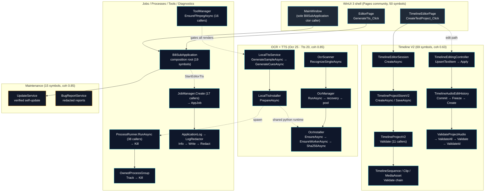

# BiliSub Studio — Architecture (graph-derived)

> Source: CodeGraph semantic graph (GitNexus retired 2026-09-15).
> Baseline numbers below were pinned from the old index of commit `e3fd178`
> (`main`, 2026-09-08): **8.263 nodes · 21.130 edges ·
> 497 communities · 710 processes · 458 files.**
> Generated 2026-09-08 from live `cypher`/`context` queries, not from
> folder browsing. Where this doc and the tree disagree, the tree wins
> and this doc is corrected in the same change.
>
> Reading note: community labels come from Leiden detection, so the
> same label repeats across fragments (`Pages` ×9, `Ocr` ×5 …). Sizes
> below are per fragment, largest first. Processes are method-level
> micro-flows (8–10 steps); the five traced in §3 were chosen as the
> most user-visible representatives, not merely the longest.

---

## 1. Overview

BiliSub Studio (`E:\du_an\BiliSub-Studio`, remote
`github.com/wan1778/BiliSub-Studio`) is a **C# / .NET 10 / WinUI 3**
Windows desktop app: Bilibili media download, local OCR/ASR/TTS,
a classic clip editor and a sandboxed **Timeline V2** multi-track
editor, with verified self-update from GitHub Releases.

The graph confirms the documented ownership split:

- **Launcher** (`csharp/src/BiliSubStudio.Launcher`) — thin root
  launcher, no feature logic.
- **App** (`csharp/src/BiliSubStudio.App`) — WinUI shell, pages,
  pickers, startup. Every page imports `BiliSubApplication`
  (graph: 11 page files + `SettingsViewModel` import it; only
  `MainWindow` constructs it).
- **Core** (`csharp/src/BiliSubStudio.Core`) — all services. The
  single composition root is `BiliSubApplication`
  (`Core/Application/BiliSubApplication.cs:18-915`).
- **tests** — contract/regression executables, the largest
  community family in the graph (top fragment: 144 symbols,
  cohesion 0.75).

No Go production source, no second backend process, no WebView —
consistent with `AGENTS.md` prohibitions (no such communities or
hubs exist in the graph).

---

## 2. Functional areas (from 497 graph communities)

Largest fragment per label (`symbols`, Leiden `cohesion`):

| Area | Largest fragment (symbols) | Cohesion | What lives there |
| --- | --- | --- | --- |
| ContractTests | 144 | 0.75 | `csharp/tests/…ContractTests` — 131 contract tests incl. all `Timeline*Contract` |
| Timeline | 69 | 0.63 | `Core/Timeline` — project v2, editing, render plan, FFmpeg mux, preview/export |
| Pages | 50 | 0.65 | `App/Pages` — `VideoPage`, `OcrPage`, `EditorPage`, `TimelineEditorPage`, `SettingsPage`… |
| Ocr | 25 | 0.66 | `Core/Ocr` — `OcrScanner`, `OcrManager`, `OcrInstaller`, reconcilers, pixel gates |
| Editor | 23 | 0.77 | `Core/Editor` — `VideoEditorService`, translation/ASR/TTS, subtitle docs |
| Tts | 20 | 0.85 | `Core/Editor/LocalTts*` — TTS service + installer (tightest non-test cluster) |
| Application | 19 | 0.69 | `Core/Application/BiliSubApplication` — composition root |
| Video | 18 | 0.93 | `Core/Video` — resolver, download service, range downloader (very cohesive) |
| Maintenance | 15 | 0.85 | `Core/Maintenance` — `UpdateService`, `BugReportService` |
| Services | 13 | 0.79 | `App/Services` — pickers, overlay composer, startup diagnostics |
| ViewModels | 13 | 0.78 | `App/ViewModels` — settings, project/queue/log items |

Cross-cutting hubs by incoming `CALLS` (the true connectors):

| Hub | File | Callers |
| --- | --- | --- |
| `ProcessRunner.RunAsync` | `Core/Processes/ProcessRunner.cs` | **38** — every external-process call funnels here |
| `TimelineMediaAsset.Create` | `Core/Timeline/TimelineMediaAsset.cs` | 32 |
| `TimelineAudioEditState.Create` | `Core/Timeline/TimelineAudio.cs` | 26 |
| `TimelineItemOps.Create`-family | `Core/Timeline/TimelineItems.cs` | 25 |
| `JobManager.Create` | `Core/Jobs/JobManager.cs` | 17 — every long job starts here |
| `ToolManager.EnsureFfmpegAsync` | `Core/Tools/ToolManager.cs` | 16 — FFmpeg gate before any render |
| `TimelineProjectV2.Validate` | `Core/Timeline/TimelineProjectV2.cs` | 11 |

Takeaway: **processes are spawned in exactly one place**
(`ProcessRunner`), **jobs in exactly one place**
(`JobManager`), **FFmpeg is gated in exactly one place**
(`ToolManager`) — the graph corroborates the cleanup-aware,
single-gate design claimed in `BUILD.md`.

---

## 3. Key execution flows (traced step-by-step in-graph)

### 3.1 Timeline text edit — `UpsertTextItem → ValidateId` (9 steps)

The G31b path, verified against the working tree:

```
TimelineEditingController.UpsertTextItem          (TimelineEditingController.cs)
  → Apply                                         (TimelineEditingController.cs)
  → TimelineAudioEditHistory.Commit               (TimelineAudio.cs)
  → Freeze                                        (TimelineAudio.cs)
  → TimelineAudioEditState.Create                 (TimelineAudio.cs)
  → ValidateProjectAudio                          (TimelineAudio.cs)
  → ValidateAll                                   (TimelineAudio.cs)
  → Validate                                      (TimelineAudio.cs)
  → ValidateId                                    (TimelineAudio.cs)
```

Atomic undo + full revalidation on every keystroke-level edit —
matches the G31 contract (`MultiTrackEditsStayAtomicAsync`).

### 3.2 Timeline project creation — `CreateTestProject_Click → Validate` (8 steps)

```
TimelineEditorPage.CreateTestProject_Click        (App/Pages/TimelineEditorPage.xaml.cs)
  → TimelineEditorSession.CreateAsync             (TimelineEditorSession.cs)
  → TimelineProjectStoreV2.CreateAsync            (TimelineProjectStoreV2.cs)
  → TimelineProjectStoreV2.SaveAsync              (TimelineProjectStoreV2.cs)
  → TimelineProjectV2.Validate                    (TimelineProjectV2.cs)
  → TimelineSequence.Validate                     (TimelineSequence.cs)
  → TimelineClip.ValidateAgainst                  (TimelineClip.cs)
  → TimelineMediaAsset.Validate                   (TimelineMediaAsset.cs)
```

UI → session → store → layered validation down to the asset.
The exact chain the G31 UIA smoke test exercised.

### 3.3 TTS generation + runtime bootstrap — `GenerateSampleAsync → Kill` (10 steps, longest flow)

```
LocalTtsService.GenerateSampleAsync               (Editor/LocalTtsService.cs)
  → GenerateCuesAsync                             (Editor/LocalTtsService.cs)
  → LocalTtsInstaller.PrepareAsync                (Editor/LocalTtsInstaller.cs)
  → OcrInstaller.EnsurePrivatePythonAsync         (Ocr/OcrInstaller.cs)
  → OcrInstaller.EnsureBasePythonAsync            (Ocr/OcrInstaller.cs)
  → ProcessRunner.RunAsync          (Processes/ProcessRunner.cs, 38 callers)
  → Kill                            (Processes/ProcessRunner.cs)
  → OwnedProcessGroup.Track/Kill                  (Processes/OwnedProcessGroup.cs)
```

Note the shared bootstrap: **TTS reuses the OCR Python
installer** — one managed runtime for both AI subsystems.

### 3.4 OCR worker ensure — `RecognizeSingleAsync → Sha256Async` (8 steps)

```
OcrScanner.RecognizeSingleAsync                   (Ocr/OcrScanner.cs)
  → OcrManager.RunAsync                           (Ocr/OcrManager.cs)
  → RunWithRecoveryAsync                          (Ocr/OcrManager.cs)
  → EnsureAsync                                   (Ocr/OcrManager.cs)
  → BuildPoolLockedAsync                          (Ocr/OcrManager.cs)
  → OcrInstaller.EnsureAsync                      (Ocr/OcrInstaller.cs)
  → EnsureWorkerAsync                             (Ocr/OcrInstaller.cs)
  → Sha256Async                                   (Ocr/OcrInstaller.cs)
```

Checksum-verified worker (`internal/ocr/worker.py`) before any
recognition — the `$verify_ocr_worker_contract` gate pins this.

#### Selective scan confirmation (current source)

`OcrScanner.RunLaneAsync` keeps native PTS and the existing bounded
adaptive windows. Balanced/Fast recognize periodic samples and otherwise use
cheap visual probes. A sampled text difference alone no longer refines the
whole window: the transition is gated on the visual probe, refinement covers
visual-boundary neighborhoods capped at eight frames, and a quiet probe falls
back to five evenly spaced confirmation frames. Stale carried followups are
discarded when a new transition supersedes them. A visual boundary nominates
its preceding frame, changed frame and two following frames; the preceding
frame supplies late evidence for short captions. Unresolved tracker state
requests two nearby confirmation frames in the next window. Selected frames
are unique, ordered and exclude the baseline sample.

The UI exposes only adaptive selective confirmation; new page requests use
the internal `balanced` identity. Device and lane selectors remain, with no
scan-mode selector. Core retains the distinct `fast` and exhaustive `accurate`
identities: their persisted checkpoints are not relabeled, migrated or deleted
by this UI change, but cannot be discovered/resumed from the single-mode page.
Recover those legacy scans with a compatible build using their original mode;
do not rename checkpoint files or substitute `balanced` in their identities.
Schema/key policy and tracker duration thresholds are unchanged; resuming
does not reprocess already-committed evidence. Synthetic scheduling contracts
are not video-quality evidence: subthreshold visual changes can still be missed,
and noisy windows can still require dense recognition.

`OcrWorkerClient` uses a pipe-local relaxed JSON encoder for single-image,
batch and visual-probe requests: base64 `+` stays literal instead of expanding
to `\u002B` (five fewer UTF-8 bytes per occurrence). This is private stdin JSON,
not HTML; quotes, backslashes and control characters remain JSON-escaped.
Decoded images, request fields and OCR decisions are unchanged. No ROI narrowing,
sampling reduction or visual-threshold adjustment is part of this optimization.
Transport byte savings are fixture-tested, not a measured field scan speedup.

The Python worker keeps an engine-local base-prediction LRU (8 entries, at most
8 MiB of retained pixel/key/result bytes plus bounded Python object overhead).
Identity is SHA-256 over shape, dtype and C-order decoded pixels, with retained
bytes also compared to rule out hash-collision reuse. Only validated base results
are cached; a failed miss batch publishes nothing. Exact duplicate batch misses
share inference, but output order and multiplicity remain unchanged. Each output
gets fresh nested result objects and runs `refine_short_text` independently with
the current request's hints. Refined results and request IDs never enter the cache.
Oversized entries bypass retention; worker/model restart discards the cache.
This is not perceptual matching: a one-pixel change still requires inference.
It cannot be expected to help moving backgrounds, and fixture model-call savings
are not real-video performance or OCR-quality measurements.

The production worker now splits PaddleOCR 3.7 into separate detection and
recognition stages with the same `PP-OCRv6_medium_det` and
`PP-OCRv6_medium_rec` models. Detection still runs for every submitted frame,
so new, moved and multi-line text is discovered; only pixel-identical
recognition crops reuse prior recognition results. Recognition batches keep the
shipped six-crop aspect-ratio ordering and padding context. A synthetic GPU
fixture with 36 rendered Chinese-caption frames, one changed background pixel
per frame and exact parsed-output comparison measured baseline `1940.3 ms`,
split `1394.4 ms`, speedup `1.39x`; the split run used 39 detections and only 7
recognition calls covering 10 crops. This is a synthetic benchmark, not a
10-hour video measurement, and it does not change duplicate reconciliation or
duration thresholds.

### 3.5 TTS click → job + redacted log — `GenerateTts_Click → QuerySecret` (8 steps)

```
EditorPage.GenerateTts_Click                      (App/Pages/EditorPage.xaml.cs)
  → BiliSubApplication.StartEditorTts             (Application/BiliSubApplication.cs)
  → JobManager.Create                             (Jobs/JobManager.cs)
  → AppJob.new                                    (Jobs/AppJob.cs)
  → ApplicationLog.Info → Write                   (Diagnostics/ApplicationLog.cs)
  → LogRedactor.Redact → QuerySecret              (Diagnostics/LogRedactor.cs)
```

Every feature funnels through `JobManager` + the shared
application log with secret redaction — the app-wide logging
contract in `AGENTS.md`, confirmed in-graph.

---

## 4. Architecture diagram (edges are real traced calls)



Dotted edges are ownership/gating relations observed across
traces; solid edges are direct calls from §3 traces.

---

## 5. Invariants the graph corroborates

1. **One constructor of `BiliSubApplication`** — only
   `MainWindow` calls it; all pages import, none compose.
2. **One process spawner** (`ProcessRunner.RunAsync`, 38
   callers) with reap in `OwnedProcessGroup` — cleanup-aware
   cancel is structural, not conventional.
3. **One job entry** (`JobManager.Create`, 17 callers) and one
   shared redacting log (`ApplicationLog`/`LogRedactor`).
4. **One FFmpeg gate** (`EnsureFfmpegAsync`, 16 callers).
5. **Validation is terminal**: creation flows end in
   `Validate…` chains; edit flows end in `ValidateId` —
   pure-function validation before persistence, per repo rule.
6. **TTS rides the OCR runtime** — a real coupling to weigh
   before touching `OcrInstaller`.

## 6. Where to look next (graph entry points)

- `codegraph brief` (or `.codegraph/REPORT.md`) for orientation;
  `codegraph list types --top 20` for hub types.
- `codegraph impact <symbol>` before editing — required by
  `AGENTS.md`.
- `codegraph path <A> <B>` for "how does A reach B".
- `codegraph diff` after changes, before commit.
- Re-run `codegraph index --solution csharp/BiliSubStudio.sln`
  after structural changes; this doc's numbers are pinned to `e3fd178`.
