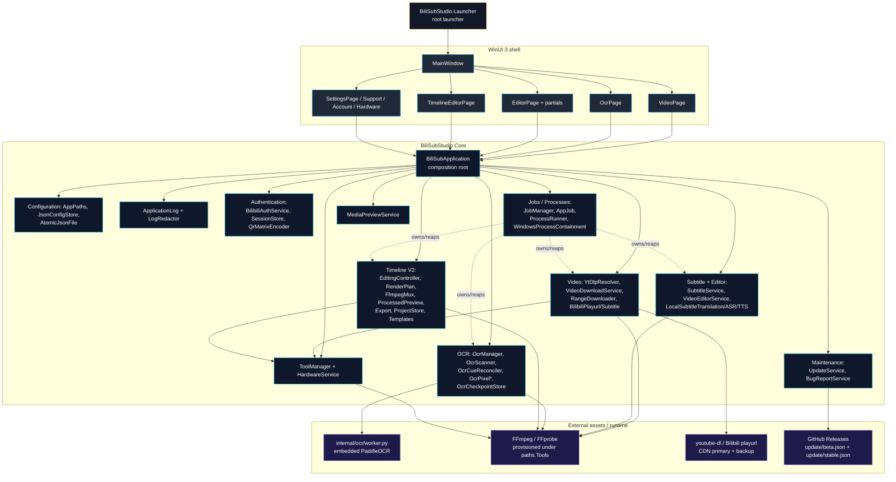

# BiliSub Studio — C# Architecture

> Generated 2026-09-08 from a fresh filesystem inspection of
> `csharp/`. Source of truth is the working tree; if a documented
> boundary drifts, the source wins and the doc is corrected in the
> same change. This document supersedes the older `ARCHITECTURE.md`
> only in form (it is a regenerated copy that matches today's tree
> and gate state).

---

## 1. Overview

BiliSub Studio is a **C# + .NET 10 + WinUI 3** Windows desktop application
for downloading Bilibili media, running local OCR / ASR / TTS, editing
subtitled videos with a classic clip-editor and a sandboxed **Timeline V2**
multi-track editor, and self-updating from verified GitHub release payloads.

Production ownership (per `AGENTS.md` and the production tree):

| Project | Role |
| --- | --- |
| `csharp/src/BiliSubStudio.App` | WinUI shell, pages, pickers, application startup. |
| `csharp/src/BiliSubStudio.Core` | Application/core services, jobs, config, media, video, subtitle, OCR, editor, auth, maintenance. |
| `csharp/src/BiliSubStudio.Launcher` | User-visible root launcher; starts `Runtime\BiliSubStudio.exe`. No feature logic. |
| `csharp/tests` | Core/transport regression executables. |
| `csharp/installer`, `csharp/scripts` | Verified Windows packaging and release gates. |
| `internal/ocr/worker.py` | Private Python PaddleOCR worker asset embedded and checksum-verified by the C# build. |

There is no Go production source, no second BiliSub backend process, no
`BiliSubStudioCore.exe`, and no localhost/browser/WebView/WebView2 in the
production UI (hard prohibitions in `AGENTS.md`).

The launch chain is **Launcher → App → Core services**. The launcher
(`csharp/src/BiliSubStudio.Launcher/Program.cs:13-31`) resolves
`<root>\Runtime\BiliSubStudio.exe` and `Process.Start`s it; the app builds
a single `BiliSubApplication` (`BiliSubApplication.cs:34-72`) which
composes every core service, then `MainWindow.xaml.cs:103-114` wires the
top-level pages (`video`, `ocr`, `editor`, `settings`, `timelinev2`).

---

## 2. Functional Areas

The Core namespace tree is the canonical decomposition. The numbered
groups below are the ones visible to callers and the verifier; each
group maps to one or more `csharp/src/BiliSubStudio.Core/<Group>/`
folders and is covered by the script-level contracts under
`csharp/scripts/verify_*.py` and the in-process contract tests
under `csharp/tests/BiliSubStudio.Core.ContractTests`.

### 2.1 Application composition (`Application/`, `Configuration/`, `Diagnostics/`, `Processes/`, `IO/`)

`BiliSubApplication` (915 LOC) is the single composition root. Its
constructor wires:

- `HttpClient` (32 connections, 10 min timeout, no auto-decompression)
- `JsonConfigStore` → `SettingsApplicationService`
- `SessionStore`, `BilibiliAuthService`
- `JobManager` + `SequentialJobQueue` for serialized video jobs
- `UpdateService`, `BugReportService`
- `ProcessRunner` + `WindowsProcessContainment`
- `ToolManager` (FFmpeg/FFprobe provisioning)
- `HardwareService`, `MediaPreviewService`, `YtDlpResolver`
- `VideoDownloadService`, `SubtitleService`
- `VideoEditorService` + `EditorProjectStore`
- `LocalSubtitleTranslationService`, `LocalAsrService`, `LocalTtsService`
- `OcrManager` + `OcrScanner` + `OcrCheckpointStore`

`AppPaths` (`Configuration/AppPaths.cs`) is the single source of root
paths (`Root`, `Data`, `Tools`, `Ocr`, `Temp`, `Cache`,
`DefaultDownloads`); `JsonConfigStore` and `AtomicJsonFile` ensure
persistent state is written atomically.

Diagnostics: `ApplicationLog` + `LogRedactor` give every page a
shared, application-wide log; the app surfaces it through the
global log panel in `MainWindow.xaml.cs`.

### 2.2 Authentication & sessions (`Authentication/`)

`BilibiliAuthService` wraps login + cookies against the in-process
`SessionStore`. `QrMatrixEncoder` produces the QR login payload
(contract pinned at version 10).

### 2.3 Video download & media resolver (`Video/`)

`YtDlpResolver` (`YtDlpResolver.cs`) discovers formats, thumbnails and
subtitles from Bilibili/YouTube. `VideoDownloadService` runs the
download job lifecycle; `RangeDownloader` handles parallel CDN
range requests with exact-size and total-mismatch guards; CDN
failover is verified by `CdnRegression` and `CdnFailoverRegression`
test executables. `BilibiliPlayurlClient` and
`BilibiliSubtitleClient` are the low-level HTTP entry points.

### 2.4 Subtitle / editor / voice (`Subtitle/`, `Editor/`)

`SubtitleService` exports SRT/VTT. The classic editor
(`VideoEditorService.cs`, 58 KB) drives the existing region-based
video editor and reuses the same export pipeline as Timeline V2 for
the preview/export parity contract. `LocalSubtitleTranslationService`,
`LocalAsrService`, `LocalTtsService` provide local AI capabilities
with explicit installer/runtime manifests, GPU policy, and
cancellation-aware jobs. `EditorSubtitleDocument`,
`EditorSubtitleManualStore`, `EditorVietnameseSubtitleWorkflow`,
and `EditorSpeechAnalysis` cover the editor-side subtitle/voice
contracts.

### 2.5 OCR (`Ocr/`, plus `internal/ocr/worker.py` asset)

`OcrManager` exposes device configuration, status, and checkpoint
recovery. `OcrScanner` (95 KB) is the primary scanner: it extracts
frames, runs pixel diffs, calls `OcrWorkerClient` (in-process Python
Paddle worker), reconciles live cues, and writes checkpoints via
`OcrCheckpointStore`. `OcrCueReconciler` and `OcrLiveTailReconciler`
own the live tail and exact-gap policies; `OcrPixelComparer` and
`OcrPixelMetrics` enforce the "production unavailable, union crop
and test comparer explicit" rule. `OcrAutoResourcePolicy` and
`OcrTopologyBenchmark` pin safe worker counts (1/2/4/8/16) and
the GPU wheel follows numeric CUDA compatibility.

### 2.6 Timeline V2 (`Timeline/`)

The Timeline V2 implementation lives entirely in `Timeline/` and
underpins the new `TimelineEditorPage`. It is a separate, sandboxed
editor (`TimelineFeatureFlags`/`BILISUB_TIMELINE_V2` kill-switch);
schema 6 with multi-track, transitions, text overlays, speed
envelopes, keyframes, color grades, and per-cue voice filters.
Files of note:

| Concern | File |
| --- | --- |
| Feature flag | `TimelineFeatureFlags.cs` |
| Pure time helpers | `TimelineTime.cs` |
| Sequence model | `TimelineSequence.cs`, `TimelineClip.cs`, `TimelineItems.cs`, `TimelineTrackV2.cs`, `TimelineTransition.cs` |
| Audio + voice | `TimelineAudio.cs`, `TimelineVoiceFilter.cs` |
| Speed envelope / keyframes / grade | `TimelineSpeedEnvelope.cs`, `TimelineKeyframes.cs`, `TimelineColorGrade.cs`, `TimelineSpeedMapping.cs`, `TimelineKeyframeGraph.cs` |
| Text overlays | `TimelineTextItem.cs`, `TimelineTextAssBuilder.cs`, `TimelineTransitionGraph.cs` |
| Templates | `TimelineTemplates.cs` |
| Compiler + render plan | `TimelineRenderPlan.cs`, `TimelineOneClipParity.cs`, `TimelineMigrator.cs` |
| FFmpeg mux/fidelity | `TimelineFfmpegMux.cs`, `TimelineFidelityMux.cs` |
| Preview | `TimelineProcessedPreviewService.cs`, `TimelineFfmpegProcessedPreviewRenderer.cs`, `TimelinePreviewController.cs`, `TimelinePreviewExportService.cs`, `TimelineProcessedPreviewService.cs` |
| Export | `TimelineExportService.cs` |
| Editing | `TimelineEditingController.cs`, `TimelineEditorSession.cs`, `TimelineViewport.cs`, `TimelineDragMath.cs` |
| Promotion / store | `TimelineProjectV2.cs`, `TimelineProjectStoreV2.cs`, `TimelineMediaAsset.cs`, `TimelineMediaRelink.cs`, `TimelinePromotionService.cs` |

### 2.7 Jobs & process control (`Jobs/`, `Processes/`)

`JobManager` and `AppJob` are the cleanup-aware cancellation
primitives shared by every long-running operation. `ProcessRunner`
and `OwnedProcessGroup` spawn and reap child processes; Windows
containment policies live in `WindowsProcessContainment`.
`SequentialJobQueue` enforces FIFO media job order while still
honoring cleanup-aware cancellation.

### 2.8 Tools, hardware, media preview (`Tools/`, `Hardware/`, `Media/`)

`ToolManager` provisions FFmpeg/FFprobe under `paths.Tools`; the
resolver checks the executable before download and refuses symlinks
and non-MZ headers. `HardwareService` reports CPU/GPU/NPU for the
auto policy. `MediaPreviewService` is the lightweight preview used
outside Timeline V2.

### 2.9 Maintenance (`Maintenance/`)

`UpdateService` is the verified-self-update path: it pulls releases
from `update/beta.json` / `update/stable.json` (both pointing to
GitHub release payloads with exact SHA-256 + size), performs the
portable runtime swap, validates PE headers, and rolls back on
invalid payload. `BugReportService` redacts secrets and Windows
user paths.

### 2.10 WinUI shell (`App/`, `App/Pages/`, `App/Services/`, `App/ViewModels/`)

`App.xaml`/`App.xaml.cs` hosts the `MainWindow`. `MainWindow.xaml.cs`
owns navigation (`Microsoft.UI.Xaml.Controls.NavigationView`),
build identity, global log surface, and the dispatcher-driven
translation progress bar. Page list:

| Page | File | Role |
| --- | --- | --- |
| `VideoPage` | `VideoPage.xaml(.cs)` | Media download / bundle entry point. |
| `OcrPage` | `OcrPage.xaml(.cs)` | OCR scanning UI. |
| `EditorPage` + 12 partials | `EditorPage.*` | Classic region-based video editor and full export pipeline. |
| `HardwarePage` | `HardwarePage.xaml(.cs)` | CPU/GPU/NPU snapshot. |
| `AccountPage` | `AccountPage.xaml(.cs)` | Bilibili login / QR. |
| `SupportPage` | `SupportPage.xaml(.cs)` | Bug report / diagnostics. |
| `SettingsPage` | `SettingsPage.xaml(.cs)` | Settings hub. |
| `TimelineEditorPage` + playback partial | `TimelineEditorPage.*` | Timeline V2 sandboxed editor. |

Services: `FolderPickerService`, `FilePickerService`,
`EditorImageOverlayComposer`, `StartupDiagnostics`. ViewModels:
`BindableBase`, `AsyncCommand`, `SettingsViewModel`,
`EditorProjectListItem`, `MediaQueueItem`, `GlobalLogItem`.

---

## 3. Top Execution Flows (Top 5 by user-visible surface)

Each flow is anchored on a public entry point, follows the call
graph into Core, and ends at the terminal side effect (UI artifact,
file, network result). The numbered arrows are described in
section 4.

### 3.1 Media download (bundled video + thumbnail + subtitle)

```
VideoPage → BiliSubApplication.StartVideo
   ├─ Jobs.Create("media", cleanupAwareCancel: true)
   ├─ SequentialJobQueue.Enqueue
   │   └─ Resolver.GetMetadataAsync (YtDlpResolver + ProcessRunner + ToolManager)
   ├─ VideoDownloadService.RunAsync     (FFmpeg / Range downloader)
   ├─ SubtitleService                   (BilibiliSubtitleClient + YtDlpResolver)
   └─ job.Finish(null, "Đã tải: " + result.OutputPath, result)
```

Entry: `BiliSubApplication.StartVideo` (`BiliSubApplication.cs:108`).
Terminal: `result.OutputPath` written under `AppPaths.DefaultDownloads`
or caller-supplied `OutputDirectory`. `BILISUB_MEDIA_BUNDLE` and
CDN failover contracts are pinned by `CdnRegression`,
`CdnFailoverRegression`, and `verify_media_bundle_contract.py`.

### 3.2 OCR scan

```
OcrPage → BiliSubApplication → OcrScanner
   ├─ OcrFrameExtractor (decode frames)
   ├─ OcrPixelComparer + OcrPixelMetrics (gate thresholds)
   ├─ OcrWorkerClient (in-process Python Paddle worker)
   ├─ OcrCueReconciler + OcrLiveTailReconciler (live cue merging)
   ├─ OcrCheckpointStore (atomic writes; recover on crash)
   └─ OcrSubtitle/SubtitleTracker (export)
```

Entry: OcrPage → BiliSubApplication. `OcrWorkerClient` shells
out to the embedded `internal/ocr/worker.py`; the runtime must
match the manifest checksum (`OcrInstaller`,
`verify_ocr_scanner_contract.py`, `verify_ocr_worker_contract.py`).

### 3.3 Classic editor export

```
EditorPage.ExportDialog → VideoEditorService.ExportAsync
   ├─ ToolManager.EnsureFfmpegAsync / EnsureFfprobeAsync
   ├─ EditorExportSettings (codec/quality/audio policy)
   ├─ FFmpeg graph build (subtitle ASS + voice TTS + music)
   ├─ ProcessRunner / WindowsProcessContainment (reap on cancel)
   └─ Output under OutputTarget directory
```

Entry: `EditorPage.ExportProject_Click`. Terminal: MP4 written.
Parity with Timeline V2 is guaranteed by
`TimelineOneClipParity.cs` + `TimelineFidelityContract.RunAsync`.

### 3.4 Timeline V2 preview / export

```
TimelineEditorPage → TimelineEditingController
   ├─ TimelineEditorSession (V2 store)
   ├─ TimelineProjectV2 (schema 6)
   ├─ TimelineCompiler.Compile → TimelineRenderPlan
   ├─ TimelineFfmpegProcessedPreviewRenderer → TimelineProcessedPreviewService
   │   ├─ TimelinePreviewController.RequestAsync (keep only latest revision)
   │   └─ MediaPlayer (WinUI) plays the artifact
   └─ TimelineExportService.ExportAsync (segment/concat/mix)
```

Entry: `TimelineEditorPage` (button-driven). Terminal: media
artifact + exported MP4. Preview reaps owned processes and stale
proxies; preview/export share `TimelineRenderPlan` so the user's
previewed state and the file they ship are byte-traceable to the
same compiled plan.

### 3.5 Self-update

```
SettingsPage (Update card) → UpdateService.ApplyAsync
   ├─ HTTP fetch update/beta.json or update/stable.json (verified SHA-256 + size)
   ├─ PE header validation
   ├─ Atomic swap of Runtime\ + Data\
   └─ Restart from launcher
```

Entry: `UpdateService` constructor receives `paths`, `_http`,
`Jobs`. Terminal: portable update; rollback on invalid payload
(`UpdateSwapContract`, `UpdateRollbackContract`).

---

## 4. Architecture Diagram (Mermaid)



Notes:

- Solid arrows are direct calls. Dotted arrows are "owns the
  process / cleanup-aware cancel" relations: every long-running
  Core service runs under a `JobManager`/`AppJob` so the app can
  reap children on cancellation or app close.
- `BiliSubApplication` is the only composition root; no Core
  service should be instantiated from a page directly.
- The Launcher is intentionally thin; if it grows logic it must
  be moved into `App` or `Core`.

---

## 5. Cross-cutting invariants

These are enforced by both production code and the script-level
contract suite. Any change that breaks one is a release blocker.

1. **Microsecond time, frame grid, sequential validation.** All
   Timeline + Editor time math is in microseconds (DEC-008).
2. **JSON persistence is atomic and snake_case.** `AtomicJsonFile`
   writes via tmp + rename; `JsonConfigStore` and the V2 store
   use the same pattern.
3. **Validation is pure-function + `InvalidDataException` tiếng
   Việt.** Records call `Validate()` on construction; composite
   graphs revalidate before write.
4. **FFmpeg graph strings are contract pinned.** Speed envelope,
   keyframes, voice filters, and multi-track compositing tests
   compare exact graph output (`TimelineSpeedKeyframeGradeContract`).
5. **Cleanup-aware cancellation.** Every long-running operation
   runs inside a `JobManager`/`AppJob`; the contract suite covers
   immediate, pausable, and cleanup-aware cancellation.
6. **Verifier gates.** `csharp/scripts/verify.ps1` runs the
   `verify_*.py` + `compile_app_codebehind_contract.py` suite;
   `package_windows_candidate.ps1` runs the packaging gates. Any
   failing gate blocks the build.
7. **Update channel pinning.** `update/beta.json` and
   `update/stable.json` only point at GitHub Release payloads
   with exact SHA-256 + size; the published beta is immutable
   (functional fixes require a new beta version).

---

## 6. Where to look next

- `csharp/src/BiliSubStudio.Core/Application/BiliSubApplication.cs`
  — composition root, primary job entry points, lifecycle.
- `csharp/src/BiliSubStudio.Core/Timeline/` — Timeline V2 implementation
  with subdirectories for store, editor, FFmpeg render, preview/export,
  text overlays, templates, audio/voice, and keyframes.
- `csharp/src/BiliSubStudio.App/MainWindow.xaml.cs` — navigation
  wiring and global log surface.
- `csharp/scripts/verify.ps1` — top-level verifier; calls the
  per-area contracts.
- `csharp/tests/BiliSubStudio.Core.ContractTests/Program.cs` —
  in-process contract suite (131 tests, all PASS at last verified
  gate beta.71).
